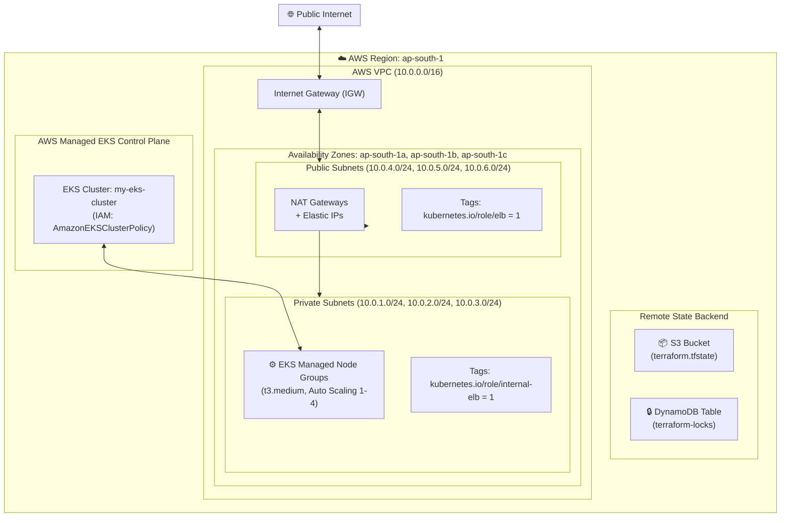

# 🚀 Production AWS VPC & EKS Cluster with Terraform

[](https://www.terraform.io/)
[](https://aws.amazon.com/)
[](https://kubernetes.io/)
[](LICENSE)

Modular, production-ready Infrastructure as Code (IaC) written in **Terraform** to provision a highly available, secure **AWS Virtual Private Cloud (VPC)** across multiple Availability Zones and deploy a managed **Amazon Elastic Kubernetes Service (EKS)** cluster with auto-scaling worker node groups.

---

## 📌 Architecture Overview



### Key Architectural Highlights
- **High Availability & Fault Tolerance**: Network spanning across 3 Availability Zones (`ap-south-1a`, `ap-south-1b`, `ap-south-1c`).
- **Network Isolation**: Worker nodes run inside private subnets without public IPs. Egress traffic to the internet (e.g. image pulls, OS patches) is routed via redundant NAT Gateways in public subnets.
- **Kubernetes Load Balancer Integration**: Subnets are tagged with `kubernetes.io/role/elb` and `kubernetes.io/role/internal-elb` for automatic AWS Load Balancer Controller integration.
- **Secure IAM**: EKS Control plane and worker node groups use isolated IAM roles adhering to least-privilege policies.
- **Remote State with Locking**: Terraform state is safely managed in an encrypted S3 bucket with state locking via DynamoDB to prevent concurrent writes.

---

## 📂 Repository Structure

```text
.
├── backend/                  # S3 and DynamoDB remote backend bootstrap
│   ├── main.tf               # Provisions S3 bucket and DynamoDB lock table
│   └── terraform.tfstate     # (Ignored) local state for backend bootstrapping
├── modules/
│   ├── vpc/                  # Custom VPC Module
│   │   ├── main.tf           # VPC, subnets, IGW, NAT Gateways, route tables
│   │   ├── variables.tf      # CIDRs, AZs, tags configuration
│   │   └── outputs.tf        # VPC ID and subnet IDs
│   └── eks/                  # Custom EKS Module
│       ├── main.tf           # EKS cluster, node groups, IAM roles and policies
│       ├── variables.tf      # Cluster configuration, node groups definitions
│       └── outputs.tf        # Cluster endpoint, cluster name, security groups
├── .gitignore                # Ignores local states, tfvars, and .terraform directories
├── main.tf                   # Root configuration invoking VPC and EKS modules
├── variables.tf              # Global inputs and cluster parameters
└── outputs.tf                # Cluster endpoint, cluster name, and VPC ID
```

---

## 📋 Prerequisites

Before getting started, ensure you have the following installed and configured:

1. **[Terraform CLI](https://developer.hashicorp.com/terraform/install)** (>= 1.5.0)
2. **[AWS CLI](https://docs.aws.amazon.com/cli/latest/userguide/getting-started-install.html)** (v2) configured with adequate IAM administrator permissions:
   ```bash
   aws configure
   ```
3. **[kubectl](https://kubernetes.io/docs/tasks/tools/)** to interact with the Kubernetes cluster.

---

## 🚀 Deployment Guide

### Step 1: Bootstrap Remote State Backend (One-Time Setup)

The root module uses an S3 bucket and a DynamoDB table for state storage and locking. First, initialize and deploy the backend infrastructure:

```bash
cd backend
terraform init
terraform apply -auto-approve
cd ..
```

> [!TIP]
> If you change the S3 bucket name in `backend/main.tf`, make sure to update the matching `backend "s3"` block in root `main.tf`.

---

### Step 2: Deploy the VPC & EKS Cluster

From the root directory:

1. **Initialize Terraform:**
   ```bash
   terraform init
   ```

2. **Inspect Execution Plan:**
   ```bash
   terraform plan
   ```

3. **Apply Configuration:**
   ```bash
   terraform apply
   ```
   *(Enter `yes` when prompted. Provisioning the EKS cluster and node groups typically takes 10–15 minutes.)*

---

### Step 3: Connect to your EKS Cluster

Once `terraform apply` finishes successfully, update your local `kubeconfig`:

```bash
aws eks update-kubeconfig --region ap-south-1 --name my-eks-cluster
```

Verify that your nodes are healthy and ready:

```bash
kubectl get nodes -o wide
kubectl get pods --all-namespaces
```

---

## ⚙️ Configuration & Variables

### Input Variables (`variables.tf`)

| Variable | Description | Type | Default |
| :--- | :--- | :--- | :--- |
| `region` | AWS deployment region | `string` | `ap-south-1` |
| `vpc_cidr` | Base CIDR block for VPC | `string` | `10.0.0.0/16` |
| `availability_zones` | List of target AZs | `list(string)` | `["ap-south-1a", "ap-south-1b", "ap-south-1c"]` |
| `private_subnet_cidrs` | Subnet CIDRs for private worker nodes | `list(string)` | `["10.0.1.0/24", "10.0.2.0/24", "10.0.3.0/24"]` |
| `public_subnet_cidrs` | Subnet CIDRs for public internet/NAT gateways | `list(string)` | `["10.0.4.0/24", "10.0.5.0/24", "10.0.6.0/24"]` |
| `cluster_name` | Name of the EKS cluster | `string` | `my-eks-cluster` |
| `cluster_version` | Target Kubernetes version | `string` | `1.30` |
| `node_groups` | Configuration map for managed worker node groups | `map(object)` | `general` (t3.medium, min: 1, desired: 2, max: 4) |

### Outputs (`outputs.tf`)

| Output | Description |
| :--- | :--- |
| `cluster_endpoint` | Endpoint URL for the EKS Kubernetes API server |
| `cluster_name` | Name of the provisioned EKS cluster |
| `vpc_id` | AWS VPC ID containing the cluster resources |

---

## 🧹 Destroying Resources

To avoid incurring ongoing AWS charges for running NAT Gateways and EC2 worker instances, tear down all resources when you are finished:

```bash
# 1. Destroy main infrastructure (EKS and VPC)
terraform destroy -auto-approve

# 2. (Optional) Destroy backend S3 and DynamoDB storage
cd backend
terraform destroy -auto-approve
cd ..
```

---

## 📄 License

This project is licensed under the [MIT License](LICENSE).
